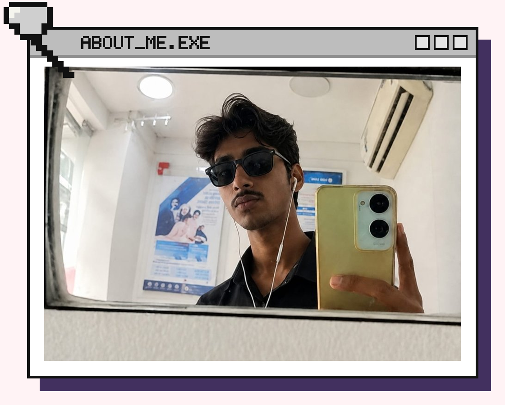
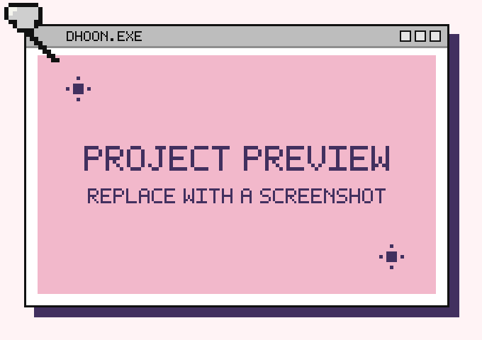

 

  

**Backend Developer & Full-Stack Engineer specializing in scalable APIs, databases, and AI systems.**
 
Ahmedabad–Gandhinagar, Gujarat, India &nbsp;·&nbsp; B.Tech CSE (Gandhinagar University) &nbsp;·&nbsp; Node.js · Express · Python · MongoDB · AI/VLMs

<!-- ======================= PAGE 02 · ABOUT ======================= -->

<h2 align="center"></h2>

<table>
<tr>
<td width="36%" valign="middle" align="center">

</td>
<td width="64%" valign="middle">

Hi, I'm **Krishna Sharma** — a Software Developer with a backend-focused approach, experienced in building scalable and reliable web applications.

I design RESTful APIs, develop robust server-side systems, model databases (MongoDB, PostgreSQL, SQL), and integrate full-stack components into complete end-to-end applications.

- 🎓 **Education:** B.Tech CSE @ Gandhinagar University (CGPA: 9.65 / 10 · 2024–2028)
- 🛠️ **Core Focus:** Scalable REST APIs, Microservices & Database Architecture
- 🤖 **AI Engineering:** Local LLM Inference (Ollama) & Cloud Model Orchestration
- 📍 **Location:** Ahmedabad–Gandhinagar, Gujarat, India &nbsp;·&nbsp; [krxna-tech.vercel.app](https://krxna-tech.vercel.app)

</td>
</tr>
</table>

<!-- ======================= PAGE 03 · EXPERTISE ======================= -->

<h2 align="center"></h2>

- **Backend Architecture & RESTful APIs.** Building scalable, production-ready server applications with Node.js, Express.js, and Python (FastAPI / Flask). Implementing secure JWT authentication, Bcrypt hashing, structured JSON pipelines, and Role-Based Access Control (RBAC).
- **Full-Stack & Database Engineering.** Developing complete web applications with React, Vite, and Tailwind CSS. Designing relational and NoSQL schemas, indexes, and queries across MongoDB (Mongoose), PostgreSQL, and SQL databases.
- **AI Integration & Model Orchestration.** Architecting practical AI workflows combining local LLM inference (Ollama), cloud model acceleration (Groq API, Llama, Qwen), speech transcription (OpenAI Whisper), and audio extraction (FFmpeg).

<!-- ======================= PAGE 04 · FEATURED PROJECTS ======================= -->

<!-- PROJECT 01: RESUME BUDDY -->
<h2 align="center"></h2>

<table>
<tr>
<td width="52%" valign="top">

### Resume Buddy: AI Resume & Career Intelligence Platform

**The problem.** Traditional Applicant Tracking Systems (ATS) rely on naive keyword matching, discarding qualified candidates without providing actionable feedback to improve resume impact.

**The solution.** An AI career-intelligence platform that parses resume PDFs and evaluates them against target job descriptions using contextual LLM analysis rather than keyword counting.

**Architecture & Key Capabilities**
- **Structured Parsing Pipeline:** Uses Multer and `pdf-parse` to convert unstructured PDF resumes into validated JSON schemas for deep inspection.
- **Dual Scoring Engine:** Links parsed data to a dual ATS-compatibility and recruiter-evaluation scoring engine:
  - *ATS Score:* Evaluates machine readability, formatting compliance, and section structure.
  - *Recruiter Score:* Evaluates quantifiable impact, project depth, and role alignment.
- **Skill Gap Analysis:** Pinpoints missing technical proficiencies and domain competencies with targeted recommendations.
- **AI Rewrite Studio:** Section-level resume rewrite engine that helps candidates rewrite bullet points with quantifiable impact and industry-standard phrasing.

 

**[📁 GitHub Repo](https://github.com/KrxnTech/Resume-Buddy)** &nbsp;·&nbsp; **[🌐 Live Demo](https://resume-buddy-green.vercel.app)**

</td>
<td width="48%" valign="middle" align="center">

</td>
</tr>
</table>

 

<!-- PROJECT 02: CONTENTHUB -->
<h2 align="center"></h2>

<table>
<tr>
<td width="48%" valign="middle" align="center">

</td>
<td width="52%" valign="top">

### ContentHub: AI Video-to-Shorts Platform

**The problem.** Manually scrubbing 4–5 minute videos to find engaging moments, resizing them for vertical formats, and generating synced subtitles is slow and repetitive.

**The solution.** A microservices platform that automatically ingests long-form videos and converts them into multiple high-engagement vertical short clips for social media repurposing.

**Architecture & Key Capabilities**
- **Audio Extraction & Timed Transcription:** Python/FastAPI microservice extracts audio tracks via FFmpeg and runs transcription with OpenAI Whisper to generate timestamped text tokens.
- **Engagement Hook Analysis:** Groq-accelerated Llama 3 models analyze transcript pacing and sentiment to detect high-retention moments and highlight clips.
- **Automated Clipping & Captions:** Programmatically crops 9:16 vertical clips, generates synchronized subtitles, and creates SEO-optimized descriptions and hashtags.
- **Cloudinary Storage Sync:** Automatically syncs processed video assets and clips to Cloudinary for media management and fast CDN delivery.

 

**[📁 GitHub Repo](https://github.com/KrxnTech/ContentHub)**

</td>
</tr>
</table>

 

<!-- PROJECT 03: DHOON -->
<h2 align="center"></h2>

<table>
<tr>
<td width="52%" valign="top">

### Dhoon: Modern React Music Streaming Web Application

**The problem.** Many web music players suffer from sluggish playback state transitions, clunky playlist management, and inconsistent audio controls across devices.

**The solution.** A responsive, modern music player web app built with React and Tailwind CSS, focused on seamless audio playback interactions, instant feedback, and a polished modern UI/UX.

**Architecture & Key Capabilities**
- **Seamless Playback Engine:** Custom audio controller with persistent playback state, smooth progress scrubbing, volume regulation, and track skipping.
- **Dynamic Playlist Management:** Interactive track queue with real-time search, album art presentation, and active song highlighting.
- **Modern Responsive Design:** Crafted with Tailwind CSS featuring fluid animations, responsive layouts for desktop and mobile, and fast client-side rendering.

 

**[📁 GitHub Repo](https://github.com/KrxnTech/Dhoooon)** &nbsp;·&nbsp; **[🌐 Live Demo](https://dhoooon.vercel.app/)**

</td>
<td width="48%" valign="middle" align="center">

</td>
</tr>
</table>

<!-- ======================= PAGE 05 · TECH STACK ======================= -->

<h2 align="center"></h2>

<table>
<tr>
<td width="50%" valign="top">
 

</td>
<td width="50%" valign="top">
 

</td>
</tr>
<tr>
<td width="50%" valign="top">
 

</td>
<td width="50%" valign="top">
 

</td>
</tr>
<tr>
<td width="50%" valign="top">
 

</td>
<td width="50%" valign="top">
 

</td>
</tr>
</table>

<!-- ======================= PAGE 06 · GITHUB JOURNEY ======================= -->

<h2 align="center"></h2>

 

 

 

⚡ Activity data updated automatically via GitHub APIs. <a href="https://github.com/KrxnTech">Visit my full GitHub profile</a>.

<!-- ======================= PAGE 07 · CONTACT ======================= -->

<h2 align="center"></h2>

<table>
<tr>
<td></td>
<td><code>github.com/KrxnTech</code></td>
</tr>
<tr>
<td></td>
<td><code>linkedin.com/in/krishna-sharma-10b5ab359</code></td>
</tr>
<tr>
<td></td>
<td><code>developerkrxna@gmail.com</code></td>
</tr>
</table>

<!-- ======================= PAGE 08 · THANK YOU ======================= -->

