

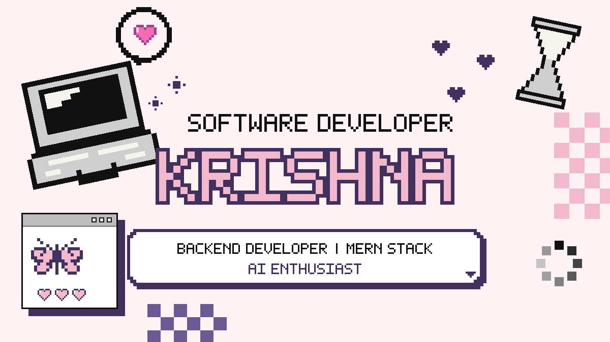

<a href="#about">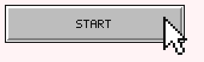</a>

 

  

**Backend Developer & Full-Stack Engineer specializing in scalable APIs, databases, and AI-powered systems.**
 
Ahmedabad–Gandhinagar, Gujarat, India &nbsp;·&nbsp; B.Tech CSE (Gandhinagar University) &nbsp;·&nbsp; Node.js · Express · Python · MongoDB · AI/VLMs

<!-- ======================= PAGE 02 · ABOUT ======================= -->

<h2 align="center">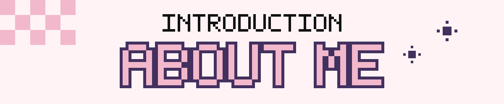</h2>

<table>
<tr>
<td width="42%" valign="middle" align="center">
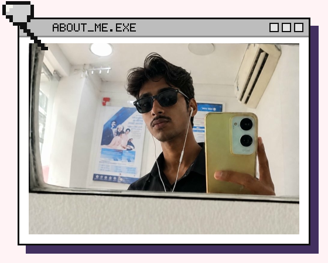
</td>
<td width="58%" valign="middle">

Hi, I'm **Krishna Sharma**, a Software Developer with a backend-focused approach, experienced in building scalable and reliable web applications.

I specialize in designing RESTful APIs, developing robust server-side systems, working with databases (MongoDB, PostgreSQL, SQL), and integrating frontend and backend components to deliver complete, end-to-end applications.

Currently pursuing my **B.Tech in Computer Science and Engineering at Gandhinagar University** (CGPA: **9.65 / 10**), my core engineering focus centers on clean system architecture, secure authentication patterns, microservice data pipelines, and intelligent AI integrations — ranging from local LLM inference via Ollama to high-throughput cloud model orchestration and multimodal vision-language platforms.

> 🎓 **B.Tech CSE @ Gandhinagar University** (CGPA: 9.65 / 10 &nbsp;·&nbsp; 2024 – 2028)  
> 🛠️ **Backend Systems, RESTful APIs, Database Design & AI Orchestration**  
> 📍 **Ahmedabad–Gandhinagar, Gujarat, India** &nbsp;·&nbsp; 🌐 [krxna-tech.vercel.app](https://krxna-tech.vercel.app)

</td>
</tr>
</table>

<!-- ======================= PAGE 03 · EXPERTISE ======================= -->

<h2 align="center">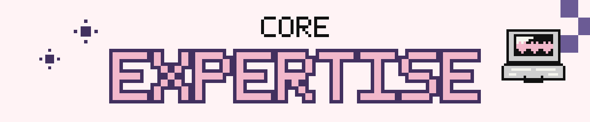</h2>

- **Backend Architecture & RESTful APIs.** Building scalable, production-ready server-side applications using Node.js, Express.js, and Python (FastAPI / Flask). Implementing secure JWT authentication in HTTP-only cookies, Bcrypt password hashing, structured JSON pipelines, and Role-Based Access Control (RBAC).
- **Full-Stack & Database Engineering.** Developing complete web applications with React, Vite, and Tailwind CSS. Designing relational and NoSQL schemas, indexes, and aggregation pipelines across MongoDB (Mongoose), PostgreSQL, and SQL databases.
- **AI Integration & Model Orchestration.** Architecting practical AI workflows combining local LLM inference (Ollama), cloud model acceleration (Groq API, Llama, Qwen), Vision-Language Models (VLMs), speech transcription (OpenAI Whisper), audio extraction (FFmpeg), and geospatial analysis (Rasterio).

<!-- ======================= PAGE 04 · FEATURED PROJECTS ======================= -->

<!-- PROJECT 01: SATVISTAAR -->
<h2 align="center">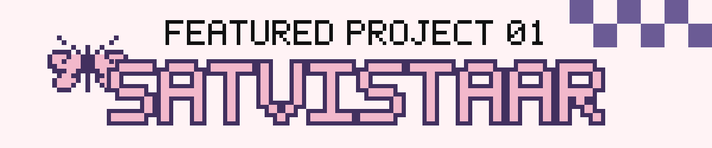</h2>

<table>
<tr>
<td width="52%" valign="top">

### SatVistaar: Autonomous Vision-Language Platform for Remote-Sensing Intelligence
*Smart India Hackathon (SIH) 2026 Project*

**The problem.** Satellite and Earth-observation data (GeoTIFF, multi-spectral, SAR) is dense and requires specialized GIS software and domain expertise. Analyzing geographic patterns, land-use shifts, and ground features programmatically through natural language has traditionally been inaccessible.

**The solution.** SatVistaar is an agentic geospatial platform that enables natural-language queries directly over satellite imagery using multimodal vision-language reasoning.

**Architecture & Key Capabilities**
- **4 Multimodal Modes:** Visual Question Answering (VQA), pixel-level feature grounding, automated scene description, and bi-temporal change detection across multi-date satellite passes.
- **Provider-Agnostic Model Router:** Engineered a model router with deterministic fallback between cloud Groq VLMs (Qwen/Llama) and a local Ollama VLM instance for latency optimization and offline resilience.
- **Geospatial Microservice:** Python/Flask microservice utilizing Rasterio to ingest GeoTIFF imagery and extract Coordinate Reference System (CRS) data, bounding boxes, and band metadata.
- **Production Security & Test Coverage:** Protected with HTTP-only cookie JWT auth and Bcrypt hashing; backed by a regression test suite achieving 21/21 auth tests and 28/30 pipeline tests passing.

 

**[📁 GitHub Repo](https://github.com/KrxnTech/SatVistaar-SIH)** &nbsp;·&nbsp; **[🌐 Live Demo](https://sat-vistaar.vercel.app)**

</td>
<td width="48%" valign="middle" align="center">
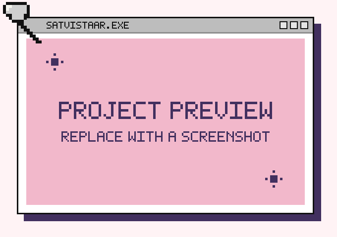
</td>
</tr>
</table>

 

<!-- PROJECT 02: RESUME BUDDY -->
<h2 align="center">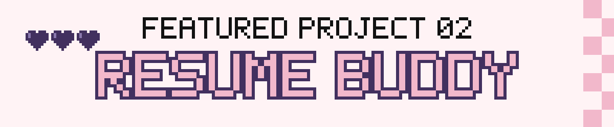</h2>

<table>
<tr>
<td width="48%" valign="middle" align="center">

</td>
<td width="52%" valign="top">

### Resume Buddy: AI Resume & Career Intelligence Platform

**The problem.** Traditional Applicant Tracking Systems (ATS) and job search tools rely on rigid keyword matching, frequently missing qualified candidates and offering no actionable guidance to improve resume impact.

**The solution.** Resume Buddy is an AI career-intelligence platform that parses resume PDFs and evaluates them against target job descriptions using contextual LLM analysis rather than naive keyword matching.

**Architecture & Key Capabilities**
- **Structured Parsing Pipeline:** Uses Multer and `pdf-parse` to convert unstructured PDF resumes into structured JSON schemas for deep inspection.
- **Dual Scoring Engine:** Links parsed data to a dual ATS-compatibility and recruiter-evaluation scoring engine:
  - *ATS Score:* Evaluates machine readability, formatting compliance, and section structure.
  - *Recruiter Score:* Evaluates quantifiable impact, project depth, and role alignment.
- **Skill Gap Analysis:** Pinpoints missing technical proficiencies and domain competencies with targeted recommendations.
- **AI Rewrite Studio:** Section-level resume rewrite engine that helps candidates rewrite bullet points with quantifiable impact and industry-standard phrasing.

 

**[📁 GitHub Repo](https://github.com/KrxnTech/Resume-Buddy)** &nbsp;·&nbsp; **[🌐 Live Demo](https://resume-buddy-green.vercel.app)**

</td>
</tr>
</table>

 

<!-- PROJECT 03: CONTENTHUB -->
<h2 align="center">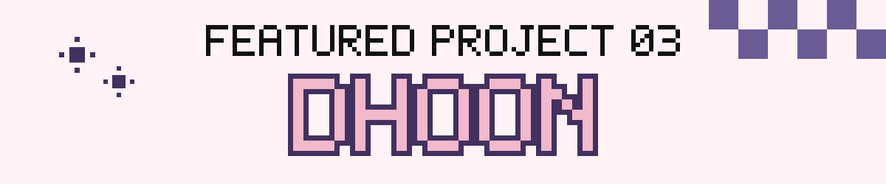</h2>

<table>
<tr>
<td width="52%" valign="top">

### ContentHub: AI Video-to-Shorts Platform

**The problem.** Manually extracting engaging moments from 4–5 minute long-form videos, resizing them for vertical formats, and creating subtitles for social media repurposing is tedious and time-consuming.

**The solution.** ContentHub is a microservices platform that automatically ingests long-form videos and converts them into multiple high-engagement short-form vertical clips for social media.

**Architecture & Key Capabilities**
- **Audio Extraction & Timed Transcription:** Python/FastAPI microservice extracts audio tracks via FFmpeg and runs transcription with OpenAI Whisper to generate timestamped text tokens.
- **Engagement Hook Analysis:** Groq-accelerated Llama 3 models analyze transcript pacing and sentiment to detect high-retention moments and highlight clips.
- **Automated Clipping & Metadata:** Programmatically crops and slices vertical clips, generates synchronized subtitles, and auto-generates titles, descriptions, and hashtags.
- **Cloudinary Storage Sync:** Automatically syncs processed video assets and clips to Cloudinary for media management and fast CDN delivery.

 

**[📁 GitHub Repo](https://github.com/KrxnTech/ContentHub)**

</td>
<td width="48%" valign="middle" align="center">

</td>
</tr>
</table>

 

### 🚀 Additional Projects

| Project | Description | Stack | Links |
|:---|:---|:---|:---:|
| **EduEase** | AI-based educational platform helping teachers streamline lesson planning and content creation using locally-hosted LLM inference and tailored prompt engineering. | React, Vite, Express, Node.js, MongoDB, Ollama API | [📁 GitHub](https://github.com/KrxnTech/EduEase) |
| **Dhoon** | Responsive web music player built with React and Tailwind CSS, focused on smooth audio playback, custom controls, and polished modern UI/UX. | React, Vite, Tailwind CSS, JavaScript | [📁 GitHub](https://github.com/KrxnTech/Dhoooon) &nbsp;·&nbsp; [🌐 Demo](https://dhoooon.vercel.app/) |
| **Production-Backend** | Scalable YouTube-like backend architecture featuring JWT authentication, Role-Based Access Control, MongoDB indexing, and Cloudinary media handling. | Node.js, Express.js, MongoDB, JWT, Cloudinary | [📁 GitHub](https://github.com/KrxnTech/Production-Backend) |

<!-- ======================= PAGE 05 · CURRENTLY BUILDING ======================= -->

<h2 align="center">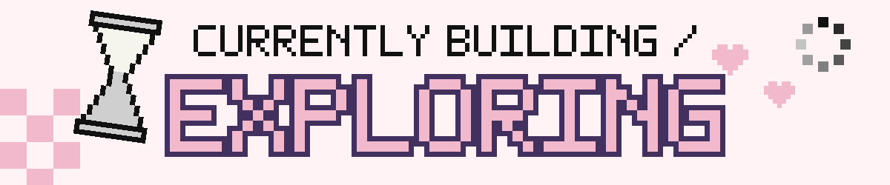</h2>

<table>
<tr>
<td width="33%" valign="top" align="center">
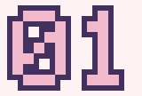 
<b>SatVistaar SIH 2026</b> 
Scaling geospatial VLM routing and multi-spectral change detection.
</td>
<td width="33%" valign="top" align="center">
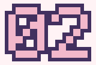 
<b>Docker & Microservices</b> 
Containerizing full-stack microservices for reproducible production builds.
</td>
<td width="33%" valign="top" align="center">
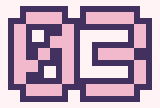 
<b>Local LLM / VLM Inference</b> 
Benchmarking low-latency edge inference with Ollama and vision models.
</td>
</tr>
<tr>
<td width="33%" valign="top" align="center">
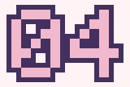 
<b>Data Structures & Algorithms</b> 
Practicing advanced problem solving, graph theory, and dynamic programming.
</td>
<td width="33%" valign="top" align="center">
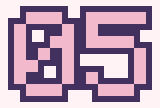 
<b>Scalable Distributed Backends</b> 
Exploring message brokers, caching strategies, and robust API rate limiting.
</td>
<td width="33%"></td>
</tr>
</table>

<!-- ======================= PAGE 06 · TECH STACK ======================= -->

<h2 align="center">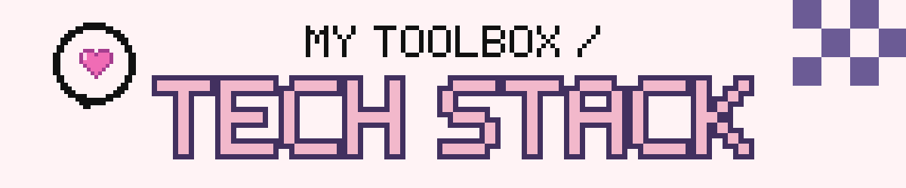</h2>

<table>
<tr>
<td width="50%" valign="top">
 

</td>
<td width="50%" valign="top">
 

</td>
</tr>
<tr>
<td width="50%" valign="top">
 

</td>
<td width="50%" valign="top">
 

</td>
</tr>
<tr>
<td width="50%" valign="top">
 

</td>
<td width="50%" valign="top">
 

</td>
</tr>
</table>

<!-- ======================= PAGE 07 · GITHUB JOURNEY ======================= -->

<h2 align="center">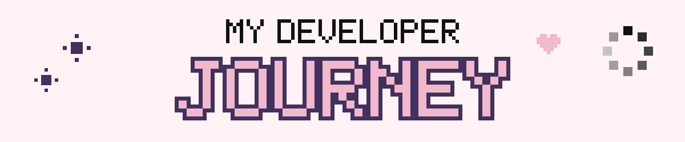</h2>

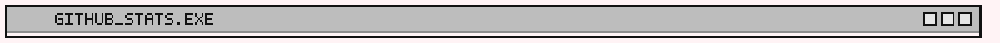

 

 

 

⚡ Activity data updated automatically via GitHub APIs. <a href="https://github.com/KrxnTech">Visit my full GitHub profile</a>.

<!-- ======================= PAGE 08 · CONTACT ======================= -->

<h2 align="center">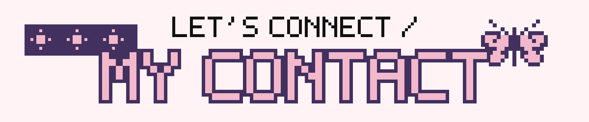</h2>

<table>
<tr>
<td></td>
<td><code>github.com/KrxnTech</code></td>
</tr>
<tr>
<td></td>
<td><code>linkedin.com/in/krishna-sharma-10b5ab359</code></td>
</tr>
<tr>
<td></td>
<td><code>developerkrxna@gmail.com</code></td>
</tr>
</table>

<!-- ======================= PAGE 09 · THANK YOU ======================= -->

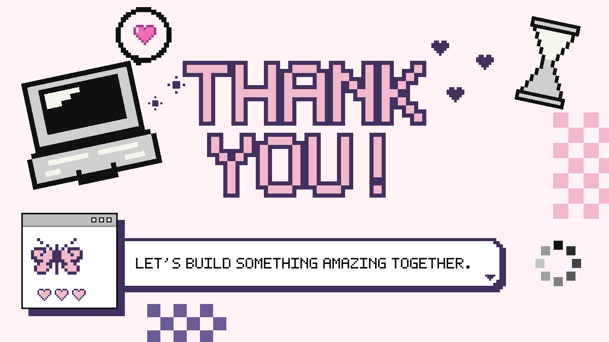

<a href="#top">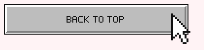</a>

