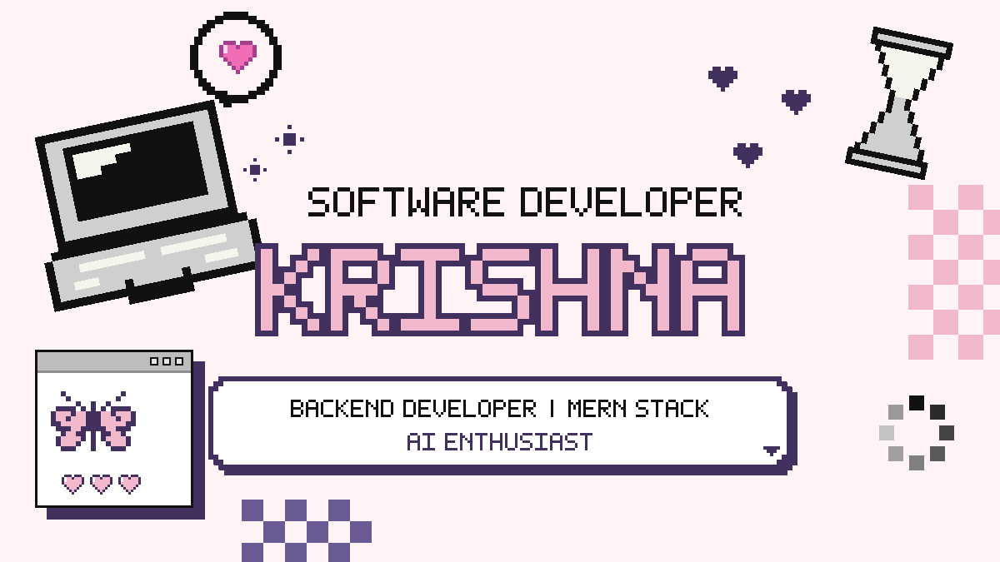
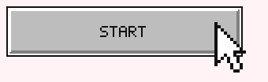
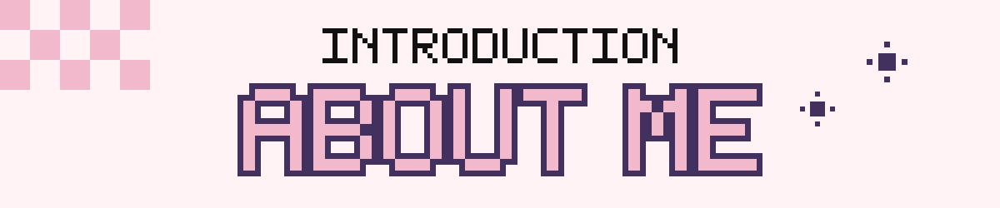
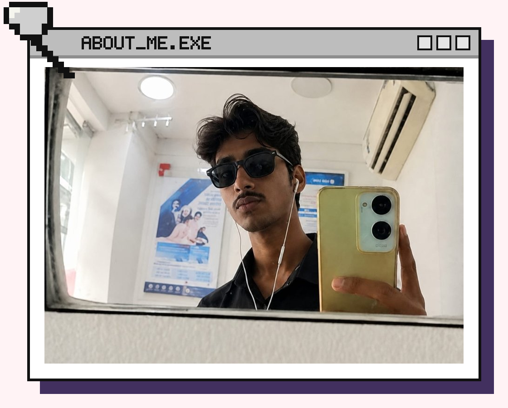
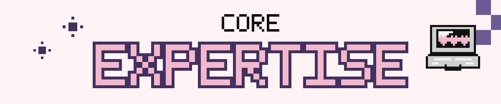
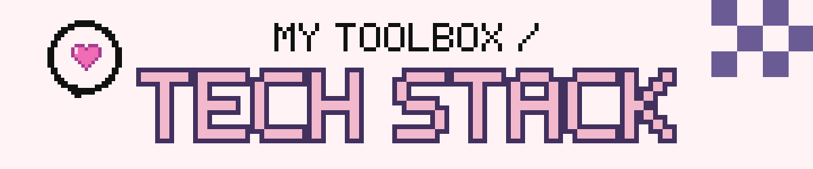
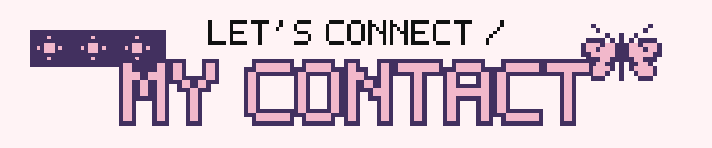
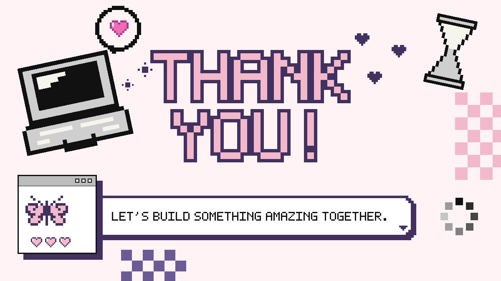
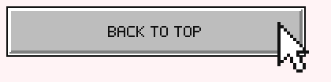

 

  

**Backend Developer & Full-Stack Engineer specializing in scalable APIs, databases, and AI systems.**
 
Ahmedabad–Gandhinagar, Gujarat, India &nbsp;·&nbsp; B.Tech CSE (Gandhinagar University) &nbsp;·&nbsp; Node.js · Express · Python · MongoDB · AI/VLMs

<!-- ======================= PAGE 02 · ABOUT ======================= -->

<h2 align="center"></h2>

<table>
<tr>
<td width="36%" valign="middle" align="center">

</td>
<td width="64%" valign="middle">

Hi, I'm **Krishna Sharma** — a Software Developer with a backend-focused approach, experienced in building scalable and reliable web applications.

I design RESTful APIs, develop robust server-side systems, model databases (MongoDB, PostgreSQL, SQL), and integrate full-stack components into complete end-to-end applications.

- 🎓 **Education:** B.Tech CSE @ Gandhinagar University (CGPA: 9.65 / 10 · 2024–2028)
- 🛠️ **Core Focus:** Scalable REST APIs, Microservices & Database Architecture
- 🤖 **AI Engineering:** Local LLM Inference (Ollama) & Cloud Model Orchestration
- 📍 **Location:** Ahmedabad–Gandhinagar, Gujarat, India &nbsp;·&nbsp; [krxna-tech.vercel.app](https://krxna-tech.vercel.app)

</td>
</tr>
</table>

<!-- ======================= PAGE 03 · EXPERTISE ======================= -->

<h2 align="center"></h2>

- **Backend Architecture & RESTful APIs.** Building scalable, production-ready server applications with Node.js, Express.js, and Python (FastAPI / Flask). Implementing secure JWT authentication, Bcrypt hashing, structured JSON pipelines, and Role-Based Access Control (RBAC).
- **Full-Stack & Database Engineering.** Developing complete web applications with React, Vite, and Tailwind CSS. Designing relational and NoSQL schemas, indexes, and queries across MongoDB (Mongoose), PostgreSQL, and SQL databases.
- **AI Integration & Model Orchestration.** Architecting practical AI workflows combining local LLM inference (Ollama), cloud model acceleration (Groq API, Llama, Qwen), speech transcription (OpenAI Whisper), and audio extraction (FFmpeg).

<!-- ======================= PAGE 05 · TECH STACK ======================= -->

<h2 align="center"></h2>

<table>
<tr>
<td width="50%" valign="top">
 

</td>
<td width="50%" valign="top">
 

</td>
</tr>
<tr>
<td width="50%" valign="top">
 

</td>
<td width="50%" valign="top">
 

</td>
</tr>
<tr>
<td width="50%" valign="top">
 

</td>
<td width="50%" valign="top">
 

</td>
</tr>
</table>

<!-- ======================= PAGE 07 · CONTACT ======================= -->

<h2 align="center"></h2>

<table>
<tr>
<td></td>
<td><code>github.com/KrxnTech</code></td>
</tr>
<tr>
<td></td>
<td><code>linkedin.com/in/krishna-sharma-10b5ab359</code></td>
</tr>
<tr>
<td></td>
<td><code>developerkrxna@gmail.com</code></td>
</tr>
</table>

<!-- ======================= PAGE 08 · THANK YOU ======================= -->

